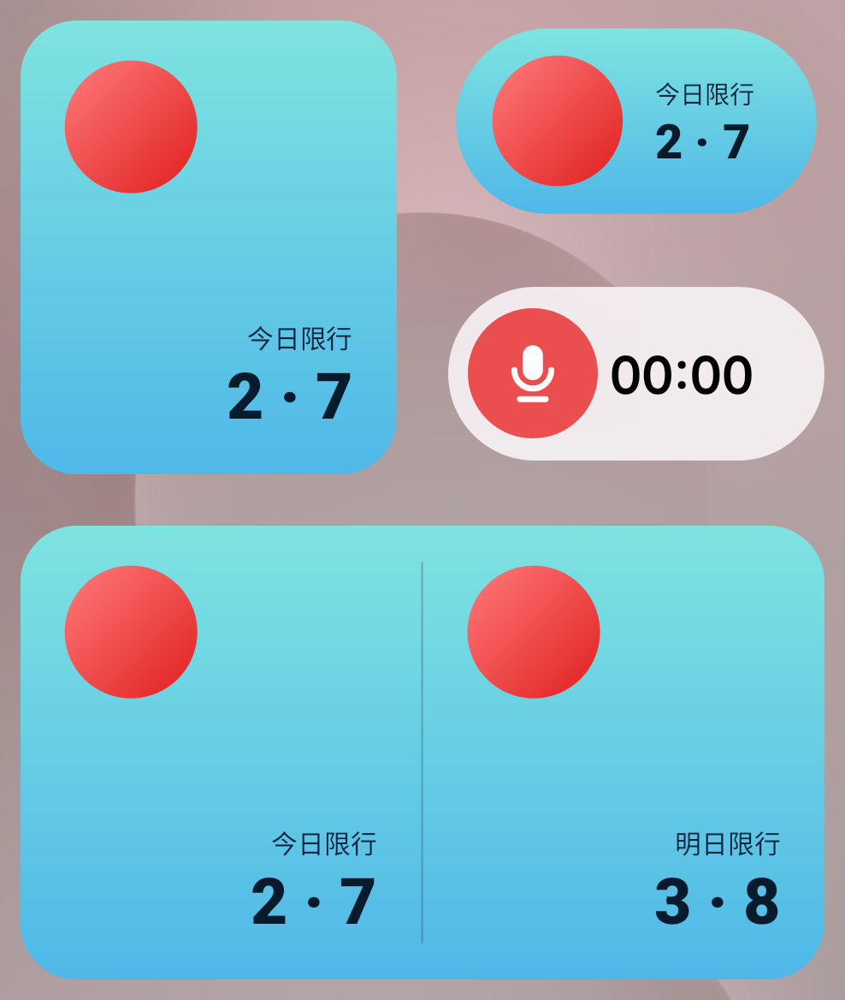
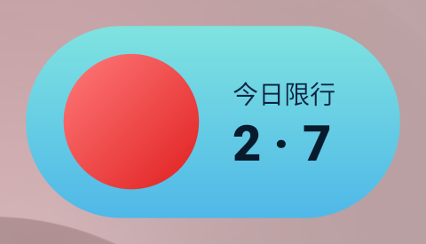
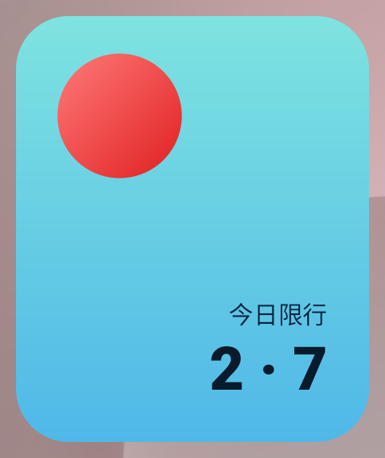
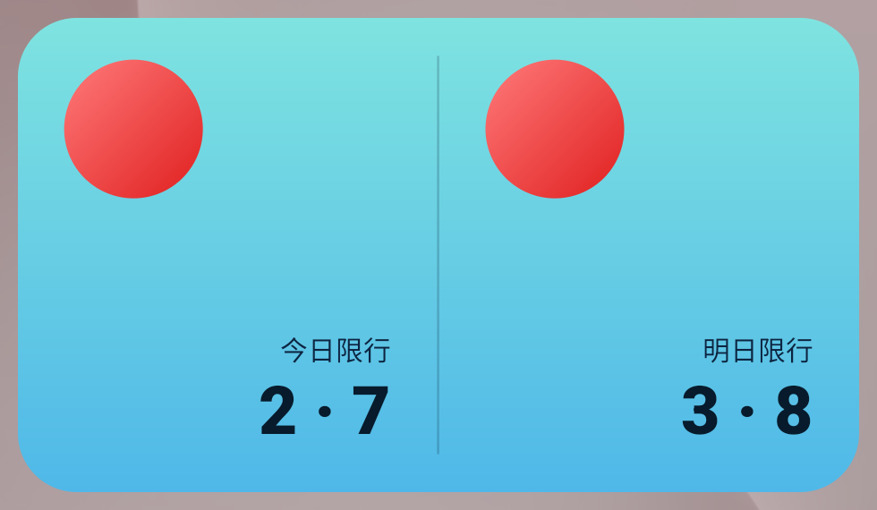
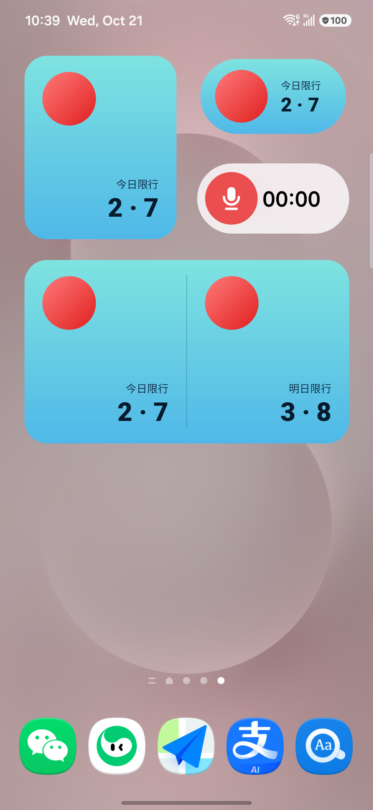

# 北京尾号限行 · 桌面小组件

一个 Android 桌面小组件，把北京的尾号限行信息放在你解锁手机第一眼就能看到的地方。

每天零点自动更新，数据来自官方通告，节假日自动识别。

  

---

## 三种尺寸

桌面长按空白处 → **小组件** → 搜索「北京尾号限行」，拖出你想要的尺寸。

### 2×1 胶囊形

只占一行，适合放在桌面顶部或底部。

  

### 2×2 方形

信息更舒展，左侧状态灯 + 右侧两行文字。

  

### 4×2 双栏

左右两栏，**左边今天、右边明天**，一眼看完两天。

  

---

## 界面说明

### 状态灯

| 颜色 | 含义 |
|---|---|
| 🔴 红色 | 今天限行 |
| 🟢 绿色 | 不限行（周末 / 法定节假日） |
| 🟡 琥珀色 | 数据待公布 |

三个尺寸的状态灯**大小一致**，观感统一。

### 文字

- **限行日**：上方小字「今日限行 / 明日限行」+ 下方大字尾号（如 `2 · 7`）。
- **不限行日**：上面那行小字会**自动隐藏**，只显示「今日不限行 / 明日不限行」一行大字。

这条规则是为了避免「今日限行」和「不限行」同时出现在一个卡片上自相矛盾。

### 深浅模式

卡片配色跟随系统深浅模式自动切换 —— 浅色下是青蓝渐变，深色下是深海蓝渐变。

**不需要打开 App 就能切换。**

  

---

## 安装

### 直接安装

下载本页 **Releases** 里最新的 `.apk`，传到手机点击安装。

首次安装需要在手机上允许「安装未知来源应用」。

- 最低系统版本：**Android 8.0**（API 26）
- 包名：`com.bradpitt.bjrestrict`

### 首次使用

1. 安装完成后，长按桌面空白处 → 小组件 → 搜索「北京尾号限行」
2. 拖出你要的尺寸到桌面
3. 点开 App，按一次「检查更新」，确认联网正常

---

## 数据来源

数据全部来自官方发布，没有使用任何第三方数据接口：

| 来源 | 用途 |
|---|---|
| 首都之窗（北京市人民政府） | 尾号限行轮换通告 |
| 中国政府网（国务院办公厅） | 法定节假日放假安排通知 |

### 更新机制

- **零点重算**：每天 00:00 自动刷新当天和次日的限行尾号。
- **每月联网**：每月自动检查一次官方通告，有更新则自动拉取。
- **周期推算**：尾号轮换按固定周期循环。官方新通告发布前，日期会按已知轮换规律自动推算，并在新通告发布后联网自动更正。

官方通告目前覆盖到 2026 年底，2027 年的限行轮换通告发布后，联网即可自动获取。

### 权限

应用只申请了三个权限，均有明确用途：

| 权限 | 用途 |
|---|---|
| `INTERNET` | 联网获取官方通告 |
| `ACCESS_NETWORK_STATE` | 判断网络是否可用，避免无网时反复重试 |
| `RECEIVE_BOOT_COMPLETED` | 开机后重新注册零点刷新任务 |

**没有申请任何读取通讯录、位置、存储、电话等权限。**

---

## 常见问题

**小组件不更新？**

部分国产系统（小米 / 华为 / OPPO / vivo 等）会限制后台任务。建议在
「设置 → 应用管理 → 北京尾号限行」里打开：

- **自启动**
- **后台运行 / 省电策略** → 设为「不限制」

不设置也能正常显示尾号，只是零点刷新和联网检查可能被系统压后。

**显示的是推测值怎么办？**

当日期超出官方已公布的通告范围时，数值会按已知轮换规律推算。等官方发布新通告后，联网即自动更正。

**周末和节假日为什么显示「不限行」？**

符合北京的实际情况 —— 周末和法定节假日不执行尾号限行。应用会自动判断，无需手动设置。

---

## 说明

- 本应用为个人开发的免费工具，与任何政府部门无关联。
- 限行信息仅供日常参考，**请以北京市官方发布的通告为准**。
- 数据获取依赖官方网页结构，若官方页面改版可能暂时抓取失败；此时应用会继续显示按规律推算的值，不会中断使用。
